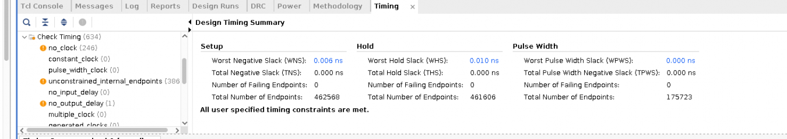
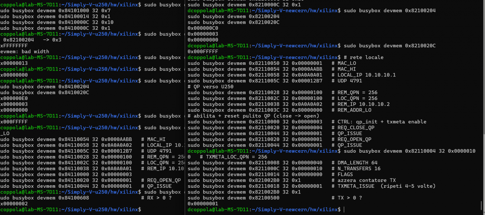

# CSR-Controlled RoCEv2 Integration in Simply-V

University internship project by **Domenico Coppola**, integrating a RoCEv2 hardware requester into the Simply-V RISC-V FPGA platform. The work adds memory-mapped control, connects the stack to a 100G Ethernet CMAC, and demonstrates generated traffic between AMD/Xilinx Alveo U280 and U250 boards.

**SystemVerilog · AXI4-Lite · AXI4-Stream · RISC-V · Vivado · 100G Ethernet**

This repository currently contains the project documentation and hardware evidence. The RTL source package is not included in this upload; [source notes](docs/source-notes.md) describe the inspected files and the version differences to reconcile for a reproducible source release.

The internship integration and hardware traffic demonstration are documented here. Subsequent transmitter experiments remain work in progress and are outside the scope of this repository and its reported results.

The prototype uses an internal payload generator. Hardware testing demonstrates activity at the Ethernet MAC boundary; a complete remote-memory write and sustained application throughput have not been demonstrated.

## My contribution

- Adapted the existing RoCEv2 stack for CSR-driven Queue Pair configuration and transfer control, replacing its UDP connection manager as the control source.
- Developed `custom_top_wrapper.sv`: a 32-bit AXI4-Lite register interface, read/write state machines, persistent configuration, and one-cycle command pulses.
- Propagated external control through `network_wrapper_roce_generic` and `RoCE_stack_wrapper`, with a single driver for each control signal.
- Integrated the custom subsystem at Simply-V's existing CMAC/FIFO interface, using a native 512-bit AXI-Stream datapath.
- Migrated the integration from the monolithic stack to the modular architecture and investigated Vivado implementation timing.
- Configured both boards through PCIe-mapped registers and checked link status and hardware packet counters.

The RoCEv2 protocol engine, Ethernet stack, and Simply-V framework are upstream work, credited below.

## Architecture

The wrapper configures network identity, Queue Pair parameters, and transfer metadata. Writes to `QP_ISSUE` and `TXMETA_ISSUE` generate command pulses independently of the stored configuration.

The integrated modular stack connects its MAC, stack, and RoCE-engine clock inputs to the same approximately **322 MHz** CMAC clock. The Simply-V control path crosses into this domain before reaching the CSR wrapper. Payloads come from the internal generator; this version does not fetch application buffers through a memory DMA path.

Read the [architecture notes](docs/architecture.md) and [register map](docs/register-map.md) for the integration details.

## Hardware results

| Item | Documented observation |
| --- | --- |
| Setup | Alveo U280 transmitter and U250 receiver connected through QSFP |
| Link | 100G CMAC bring-up, RX status and block-lock checks |
| Stimulus | QPN 256, generated 64-byte transfers, request for 16 transfers |
| Traffic | Sender TX and receiver RX CMAC packet counters showed activity |
| U250 implementation | Optimized timing report: WNS **+0.006 ns**, TNS **0 ns**, zero failing setup endpoints |

The U250 run used `Performance_ExplorePostRoutePhysOpt`. The screenshot also shows `no_clock` and unconstrained-path warnings, so the positive slack applies to analyzed paths and does not establish complete timing sign-off.

CMAC counters support the traffic demonstration. They do not prove payload integrity, destination-memory contents, RoCE completion, or useful throughput. **100 Gb/s describes the Ethernet link rate**, rather than a measured application result.

## Current limitations and next steps

- The tested configuration lacks an RDMA WRITE responder and ACK-generation path. Completion-dependent telemetry therefore remains zero in the two-FPGA experiment.
- Payloads are synthetic; real application data and receive-side memory writes remain to be integrated.
- Both endpoints require manual network and QP configuration. The internal generators expect local QPN `256 + i`.
- Clock constraints, data integrity, completion behavior, latency, and throughput need further validation.

The next steps are a validated responder/ACK path, external data-source selection at the TX-engine input, receive-side memory integration, and reproducible end-to-end tests.

## Build and source notes

The lab notes describe U250 work with Vivado **2024.2** and U280 work with **2023.1**. The inspected source snapshot contains different wrapper versions and build-packaging inconsistencies. The [build and test guide](docs/build-and-test.md) records the original workflow; [source notes](docs/source-notes.md) identify the items to reconcile before reproducing it.

## Credits

- [HiSA-Team / Simply-V](https://github.com/HiSA-Team/Simply-V): RISC-V FPGA SoC framework and CMAC integration. The project notes credit the original CMAC integration point to Manuel Maddaluno.
- [Gabriele-bot / 100G-verilog-RoCEv2-lite](https://github.com/Gabriele-bot/100G-verilog-RoCEv2-lite): underlying RoCEv2 hardware stack.
- [Alex Forencich / verilog-ethernet](https://github.com/alexforencich/verilog-ethernet): Ethernet/IP/UDP infrastructure used by the stack.
- [AMD PG203](https://docs.amd.com/r/en-US/pg203-cmac-usplus/Introduction): UltraScale+ Integrated 100G Ethernet Subsystem documentation.

The figures are retained from the project notes, with their original Italian labels. Keep upstream authorship and license notices with their respective sources; this documentation does not assign a new license to third-party RTL.
