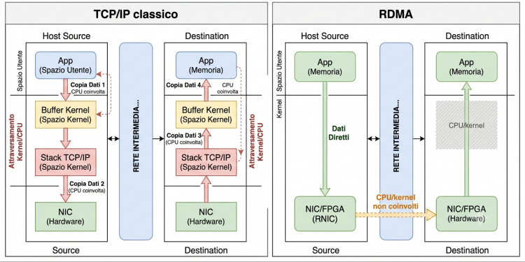
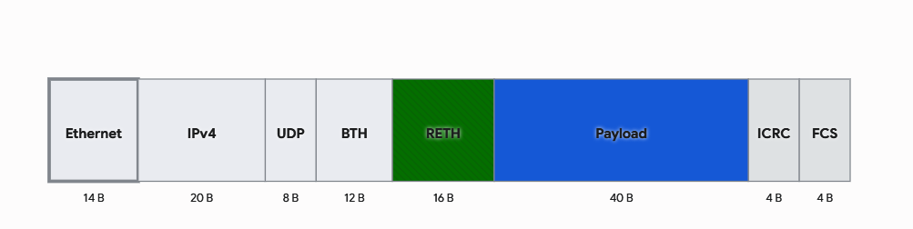
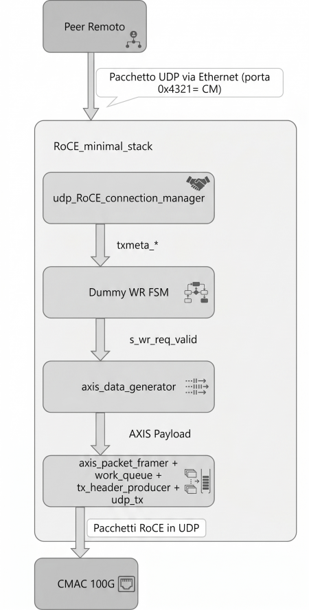
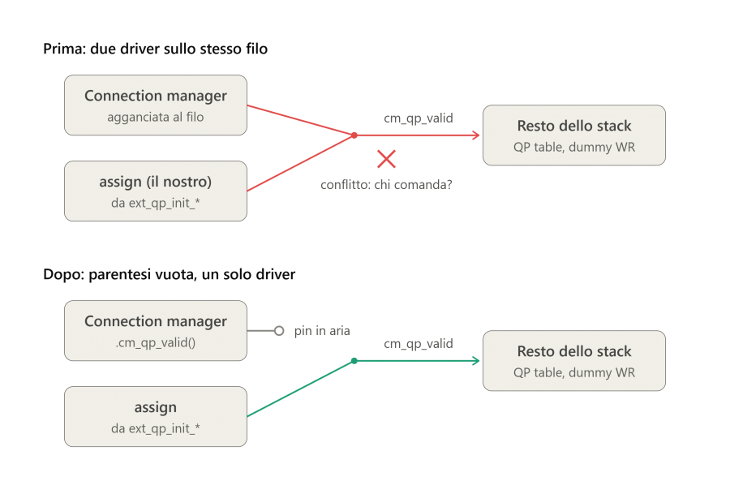
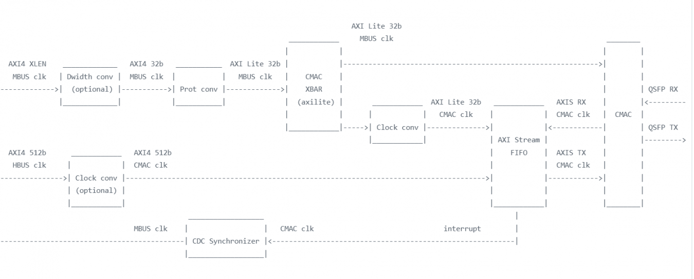

# Architecture and integration

[Back to README](../README.md)

## RDMA context

RDMA lets capable endpoints access registered remote memory with little CPU involvement in the established data path. Kernel bypass and avoiding intermediate copies are properties of the general RDMA model; this prototype does not yet implement an application-memory-to-remote-memory data path.

RoCEv2 carries RDMA transport over UDP/IP, normally using UDP port 4791. Unlike Ethernet-only RoCEv1, the IP encapsulation permits routing between subnets.

This is a conceptual diagram from the original notes. Setup, memory registration, and error handling can still involve software; the labels should not be read as a claim that all RDMA operations eliminate every CPU or kernel activity.

Queue Pairs identify communication contexts. Work requests specify an operation and its data; packet sequence numbers support transport ordering. The selected upstream stack supplies the transport machinery. This integration controls the requester and uses its generated payloads.

The figure illustrates a WRITE packet with a 40-byte example payload. Header presence depends on opcode and segmentation. Ethernet, IPv4, UDP, BTH and RETH are 14, 20, 8, 12 and 16 bytes respectively in the illustrated untagged, no-IP-options case; ICRC and Ethernet FCS are 4 bytes each. The diagram is not a universal layout for every RoCE operation.

## From the original stack to register control

The initial implementation used `RoCE_minimal_stack`. The later modular design uses `RoCE_stack_wrapper`, with separate modules for request generation, TX processing, arbitration, and retransmission.

This figure describes the **legacy control flow**, where the UDP connection manager supplies QP and transfer metadata. It is not the final CSR-controlled architecture.

The integration adds two external signal groups:

- `ext_qp_init_*`: enable/issue, operation type, keys, QPNs, PSNs, remote IP, and remote address.
- `ext_txmeta_*`: enable/valid/start, local QPN, operation flags, length, transfer count, and pacing.

These ports are forwarded through `network_wrapper_roce_generic` into `RoCE_stack_wrapper`. The connection manager's corresponding outputs are disconnected before the CSR-controlled signals drive the internal wires. This avoids two sources driving the same net; it is a replacement of the control source, rather than runtime selection between UDP and CSR control.

## Custom CSR wrapper

`custom_top_wrapper.sv` is the RTL module name; `custom_rdma_subsystem` is the packaged Simply-V IP name.

The wrapper exposes a 32-bit AXI4-Lite slave for configuration and 512-bit AXI-Stream TX/RX interfaces toward the CMAC. Its write state machine accepts an address, accepts data, and returns a response. Its read state machine captures the decoded register value and holds the response until accepted.

Configuration values persist until rewritten or reset. Issue registers produce one-cycle pulses. The wiring deliberately distinguishes transfer control from QP commands:

| Control | Wrapper wiring |
| --- | --- |
| Transfer enable and valid | `CTRL[0]` |
| Transfer start | Pulse from `TXMETA_ISSUE` |
| QP enable | `CTRL[1]` |
| QP valid | Pulse from `QP_ISSUE` |

The transfer generator starts when its valid/start conditions are met. Configuration should therefore be written before issuing a command.

The modular upstream stack exposes multiple clock inputs. In the root integration wrapper, `clk_mac`, `clk_stack` and `clk_roce_eng` all use `clk_i`, approximately 322 MHz. The engine period parameter is set to `3.105` ns. Support for asynchronous domains upstream should not be confused with a separately clocked RoCE engine in this integration.

## Simply-V integration point

The original slot contains a packet FIFO between the control/data buses and the CMAC. The integration replaces that slot with the custom subsystem while retaining the existing CSR address window and control-path conversion.

The RDMA wrapper already uses 512-bit AXI-Stream, so the packet path connects directly to the CMAC instead of using the old FIFO's 32-to-512-bit width conversion. Interrupt-driven completion is not part of this prototype; software uses register reads.

The wiki describes removing the unused memory-mapped packet-data infrastructure. The inspected HPC bus CSV reflects a reduced bus configuration, but the copied `simplyv.sv` still contains legacy data-port wiring. See [source notes](source-notes.md) before treating the current folder as the exact tested build.

## Connecting real data later

The current network wrapper ties the external raw work-request and payload inputs inactive, and the stack connects internal generated traffic to the TX engine. Supporting application data therefore requires exposing the interfaces **and** replacing or multiplexing the internal generator at the TX-engine input.

A possible first step is a small staging buffer and work-request controller. A receive-side extension would need WRITE parsing, validated addressing/key handling, payload extraction, and a memory interface. ACK generation and error handling must be validated alongside the data path.

The original notes discuss reusing existing UDP arbitration and ICRC-generation logic. These are design ideas requiring implementation and tests, not verified responder features. An RX tap also needs an explicit buffering/overflow policy; observing a stream without backpressure does not by itself guarantee lossless delivery or zero timing impact.
