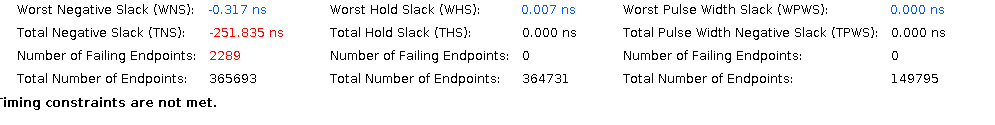

# Build flow and hardware observations

[Back to README](../README.md)

This page records the lab workflow and supplied evidence. The current source copy has the inconsistencies listed in [source notes](source-notes.md); no FPGA compilation, hardware programming, or hardware test was run while preparing this documentation.

## Environment

| Target | Environment recorded in the project notes |
| --- | --- |
| Alveo U250 | Vivado 2024.2; HPC profile; `au250` |
| Alveo U280 | Vivado 2023.1; HPC profile; `au280` |

The flow also requires the appropriate board files, IP dependencies and CMAC licensing. The hardware experiments use Linux host tools, PCIe register access, and a QSFP connection between the boards.

## Documented build sequence

First initialize the appropriate Vivado environment using its installed `settings64.sh`. From the Simply-V root, the recorded sequence is:

```bash
# In this source layout: cd SimplyV/Simply-V
source settings.sh hpc au250
make config
make units
make hw
```

For the U280 configuration, the notes use `source settings.sh hpc au280` with Vivado 2023.1 and board/environment adjustments. Do not infer that changing the board argument alone reproduces that experiment.

`make config` generates bus/configuration outputs; `make units` prepares dependency RTL; `make hw` runs the FPGA build. The inspected RDMA fetch script clones branch `u250` from a configured fork and flattens sources. Its output is not automatically the same as the root RTL in the provided folder. Synchronize and pin those inputs before rebuilding.

## Implementation timing

The supplied U250 figures show the following setup-timing progression:

| Configuration | WNS | TNS | Failing endpoints |
| --- | --- | --- | --- |
| Monolithic baseline | `-0.317 ns` | `-251.835 ns` | 2289 |
| Modular stack, initial implementation | `-0.170 ns` | `-3.073 ns` | 49 |
| Optimized implementation | `+0.006 ns` | `0.000 ns` | 0 |

The optimized run used `Performance_ExplorePostRoutePhysOpt`; the notes attribute the difficult paths to routing and SLR crossings. This is an implementation observation, not a proof that refactoring or a single strategy guarantees closure for every build.




The [optimized report](images/timing-optimized.png) also contains clock/constraint warnings. Review `no_clock` and unconstrained paths, confirm all intended clocks and exceptions, and retain full reports before claiming complete timing sign-off.

## Hardware bring-up

The documented procedure is:

1. Program the matching bitstream through the Simply-V hardware flow. The notes use `make program_bitstream` from `hw/xilinx`.
2. Select the actual PCIe BDF and refresh the host's mapping after reprogramming, following the platform procedure.
3. Discover the current BAR address with `lspci`; derive the CMAC and RDMA CSR bases from the configured address map.
4. Initialize both CMACs, then check link status and RX block lock.
5. Configure the two endpoints with matching local/remote IPs, QPNs, PSNs, keys and address fields.
6. Enable QP commands, issue CLOSE then OPEN for a clean test state, and configure transfer metadata.
7. Use the CMAC `TICK` operation to establish a sampling interval, issue `TXMETA_ISSUE`, then latch and read sender TX and receiver RX packet counts for that interval.

In the lab configuration, CMAC CSR was at `BAR + 0x100000` and RDMA CSR at `BAR + 0x110000`. The recorded host mapped U280 at `0x82000000` and U250 at `0x84000000`; these absolute addresses are examples from that machine, not portable constants.

### Recorded CMAC initialization

The following are CMAC-base-relative offsets and values transcribed from the experiment. Confirm the selected IP revision and configuration against [AMD PG203](https://docs.amd.com/r/en-US/pg203-cmac-usplus/Introduction) before reusing them.

| Offset | Written value | Purpose recorded in the notes |
| --- | --- | --- |
| `0x107C` | `0x3` | RS-FEC setup |
| `0x1000` | `0x7` | RS-FEC setup |
| `0x0014` | `0x1` | RX enable |
| `0x000C` | `0x10` | Remote-fault indication during bring-up |
| `0x000C` | `0x1` | TX enable |

The notes then read RX status at `+0x0204` twice and block lock at `+0x020C`. Observed values were `0x03` and `0x000FFFFF`. The packet counters used were TX at `+0x0500` and RX at `+0x0608`. The recorded counter-sampling flow writes `1` to `TICK` at CMAC `+0x02B0` to latch a fresh snapshot before reading the counters, consistent with the [PG203 register description](https://docs.amd.com/r/en-US/pg203-cmac-usplus/Register-Descriptions). The lab notes describe interval accumulators being cleared at each tick: do not interpret the readable snapshots as monotonically increasing lifetime counts.

The lab playbook reports host instability when repeatedly reading an inaccessible mapping returning `0xFFFFFFFF`. Validate the mapping first and stop on unexpected all-ones reads instead of polling it blindly.

## Traffic stimulus and interpretation

The final wiki records QPN **256**, transfer length **64 bytes**, requested transfer count **16**, and pacing value **0**. An earlier playbook contains example QPNs 22/23; those examples do not satisfy the inspected internal-generator convention and should not be copied into this test.

`CTRL[0]` enables transfer metadata; `CTRL[1]` enables QP commands. Writing `1` to `QP_ISSUE` or `TXMETA_ISSUE` generates the relevant pulse. See the [register map](register-map.md) for exact fields and reset values.

The supplied terminal capture shows CMAC counter activity across the two boards. A requested count of 16 transfers is stimulus configuration, not a demonstrated count of 16 completed writes. ARP and retransmission traffic may also affect aggregate packet counters.

The test therefore establishes link bring-up and observed MAC-level traffic. It does not establish a functioning WRITE responder, remote-memory modification, ACK completion, error-free payload delivery, or a measured 100 Gb/s data rate. Packet capture, payload checking, completed transactions and controlled counter-sampling intervals are useful next validation steps.
